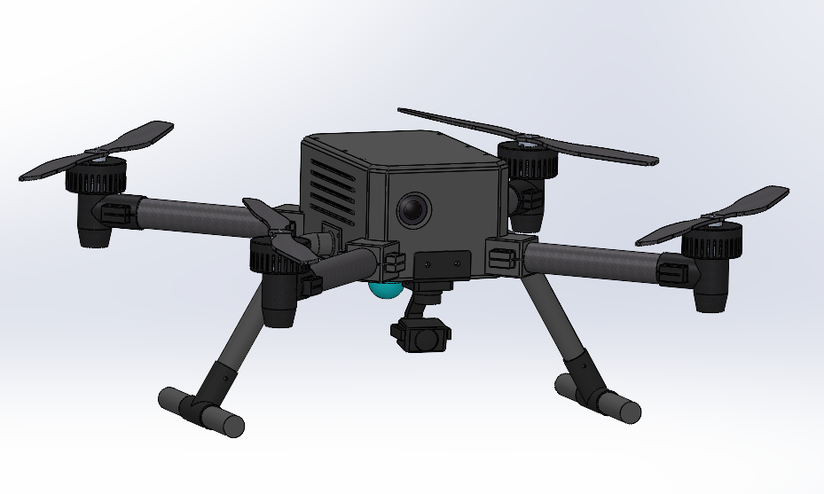
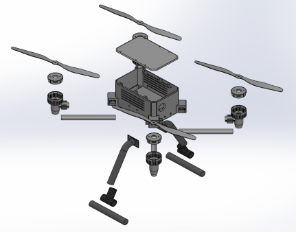
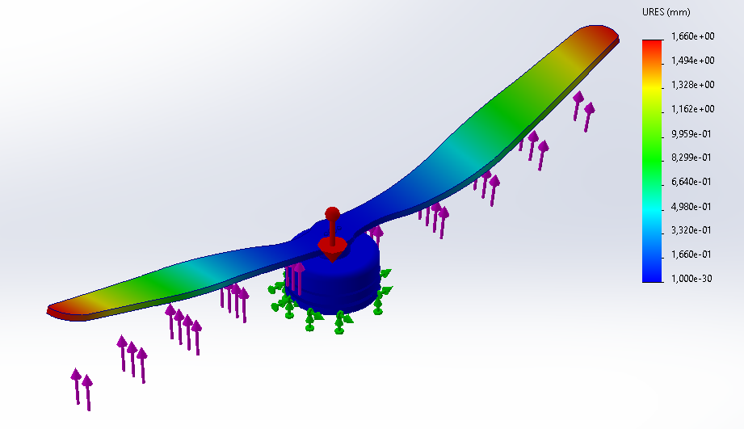
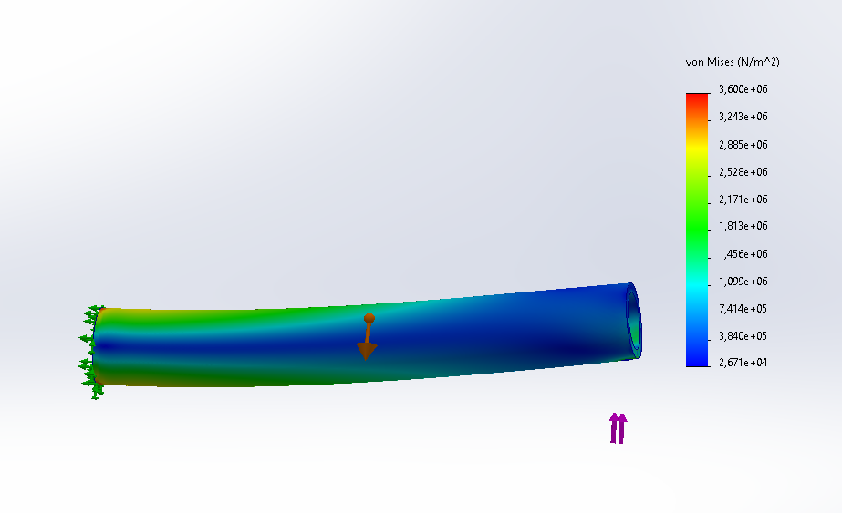
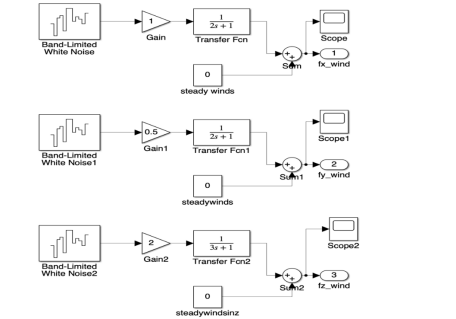
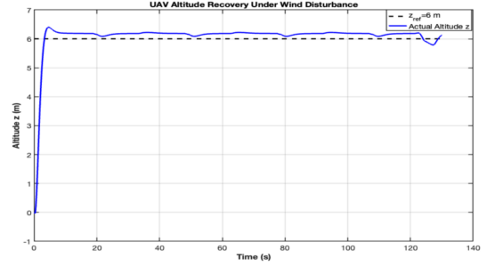

# Search & Rescue UAV

Mechanical design and engineering analysis showcase · Graduation Project · 2026

[Türkçe açıklama](README.tr.md)

## Project Overview

A search-and-rescue UAV project using UWB and LiDAR technologies for target detection and environmental mapping. This page presents my mechanical engineering contributions and selected design, analysis, and team control-system visuals.

*Overall CAD assembly. This image shows the digital design.*

## Mechanical Assembly

*Exploded CAD view showing the mechanical assembly and component arrangement.*

## My Contribution

- Took responsibility for the mechanical design, including fastener selection and design.
- Performed static and dynamic analyses of mechanical components.
- Used SolidWorks for mechanical design and analysis.
- Supported control system work using MATLAB/Simulink.
- Presented the project methodology and simulation results at MEKON 2026.

## Selected Analysis Visuals

### Propeller — Resultant Displacement

*Selected propeller displacement plot from SolidWorks. The legend reports resultant displacement (URES) in millimetres for the illustrated analysis setup.*

### Arm — von Mises Stress

*Selected arm stress plot from SolidWorks. The legend reports von Mises stress in N/m² for the illustrated analysis setup.*

These plots are examples of the analysis work. Quantitative comparison with analytical calculations requires matching the geometry, material properties, loads, and boundary conditions.

## Control & Simulation — Team Work

The control-system work was carried out collaboratively. My main responsibility was mechanical design and analysis, and I supported the control-system work. The following figures are excerpts from the team's graduation thesis and illustrate the shared project work.

### Wind-Disturbance Model

*Team project figure: Simulink model of wind-disturbance inputs along three axes.*

### Altitude Response Under Wind Disturbance

*Team project result: simulated altitude response, with reference altitude and simulated altitude shown. This figure is a simulation result.*

## Tools

SolidWorks · MATLAB · Simulink

## Portfolio Scope

This repository contains selected visuals and summary documentation. Original CAD models, simulation files, detailed calculations, and the full thesis remain outside this public showcase.
