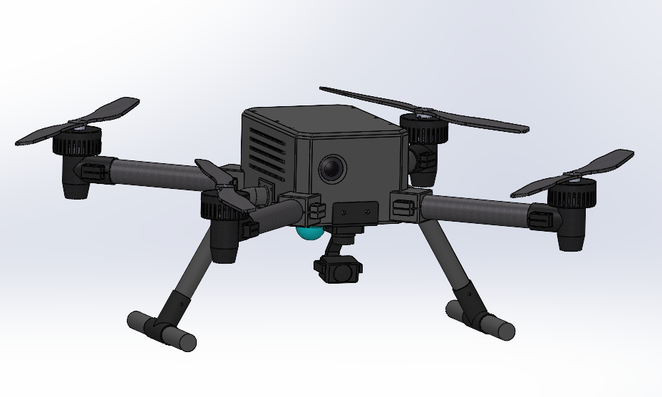
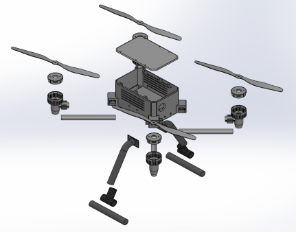
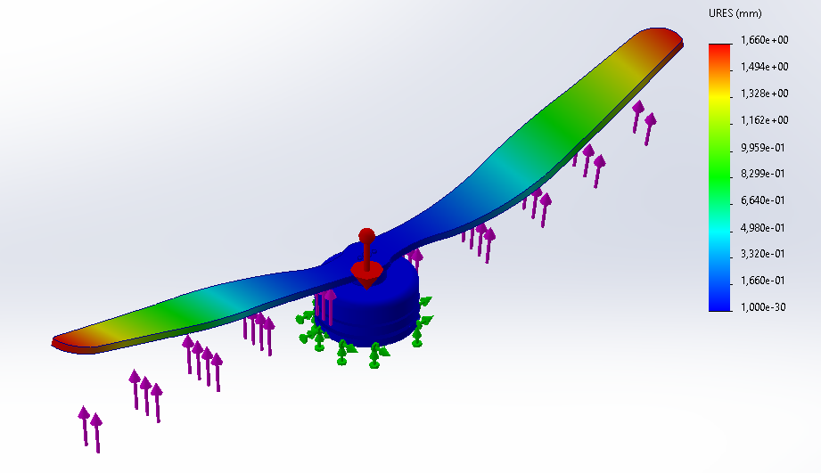
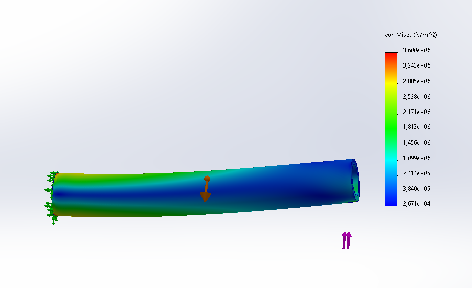
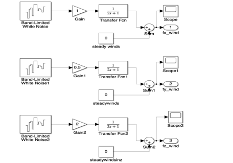
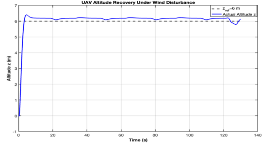

# Arama Kurtarma İHA’sı

Mekanik tasarım ve mühendislik analizi portföyü · Bitirme Projesi · 2026

[English version](README.eng.md)

## Proje Özeti

Hedef tespiti ve çevre haritalama amacıyla UWB ve LiDAR teknolojilerini kullanan arama kurtarma İHA’sı projesi. Bu sayfa, projedeki mekanik mühendisliği katkılarımı ve seçilmiş tasarım, analiz ve ekibin kontrol sistemi çalışmalarından görselleri sunar.

*Genel CAD montajı. Görsel dijital tasarımı göstermektedir.*

## Mekanik Montaj

*Mekanik montajı ve bileşen yerleşimini gösteren patlatılmış CAD görünüşü.*

## Projedeki Katkım

- Bağlantı elemanlarının seçimi ve tasarımı dâhil mekanik tasarım çalışmalarını üstlendim.
- Mekanik bileşenlerin statik ve dinamik analizlerini gerçekleştirdim.
- Mekanik tasarım ve analiz çalışmalarında SolidWorks kullandım.
- MATLAB/Simulink ile yürütülen kontrol sistemi çalışmalarına destek verdim.
- Proje yöntemini ve simülasyon sonuçlarını MEKON 2026’da sundum.

## Seçilmiş Analiz Görselleri

### Pervane — Bileşke Yer Değiştirme

*SolidWorks’ten seçilmiş pervane yer değiştirme görseli. Ölçek, gösterilen analiz düzeni için bileşke yer değiştirmeyi (URES) milimetre cinsinden ifade eder.*

### Kol — von Mises Gerilmesi

*SolidWorks’ten seçilmiş kol gerilme görseli. Ölçek, gösterilen analiz düzeni için von Mises gerilmesini N/m² cinsinden ifade eder.*

Bu görseller analiz çalışmalarından örneklerdir. Analitik hesaplarla sayısal karşılaştırma yapılması; geometri, malzeme özellikleri, yükler ve sınır koşullarının eşleştirilmesini gerektirir.

## Kontrol ve Simülasyon — Ekip Çalışması

Kontrol sistemi çalışmaları ekip tarafından yürütülmüştür. Ana sorumluluğum mekanik tasarım ve analiz olup kontrol sistemi çalışmalarına destek verdim. Aşağıdaki görseller ekibin bitirme tezinden alınmıştır ve ortak proje çalışmalarını göstermektedir.

### Rüzgâr Bozucusu Modeli

*Ekip çalışmasına ait görsel: üç eksende rüzgâr bozucu girişlerini oluşturan Simulink modeli.*

### Rüzgâr Bozucusu Altında İrtifa Tepkisi

*Ekip çalışmasına ait sonuç: referans irtifa ve simülasyon irtifasının gösterildiği tepki grafiği. Görsel bir simülasyon sonucudur.*

## Kullanılan Araçlar

SolidWorks · MATLAB · Simulink

## Portföy Kapsamı

Bu depoda seçilmiş görseller ve özet açıklamalar bulunur. Orijinal CAD modelleri, simülasyon dosyaları, ayrıntılı hesaplar ve tam tez bu açık tanıtım alanına dâhil değildir.
